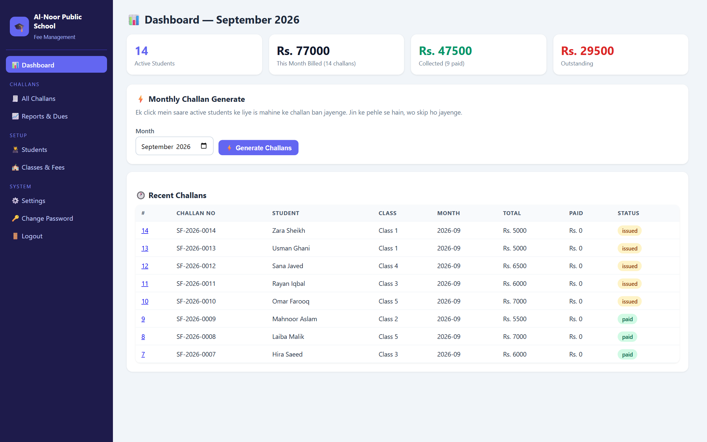

# School Fee Management System

Fee management for schools, academies, tuition centres and coaching institutes — classes and fee structures, one-click monthly challan generation, payment recording, dues tracking and printable challans.

**[Live demo](https://ahsan-school-fees.vercel.app)** · Login: `admin` / `admin123`



## Features

**Students & classes**
- Student records with roll number, guardian contact and class
- Classes with monthly fee structure (tuition, transport, other heads)
- Admission date, status and discounts

**Fee challans**
- One-click generation of monthly challans for an entire class or school
- Unique challan number per month, due date and fine support
- Printable A4 challan with school header, fee breakdown and bank details

**Payments & dues**
- Record full or partial payments (cash / bank / online) with date and reference
- Receipt printing, payment history per student
- Outstanding, defaulter list and month-wise collection reports

**Administration**
- School settings (name, address, logo, fee heads, bank details)
- Staff accounts, password change, automatic backups

## Tech stack

Python 3 · Flask · SQLite · Jinja2 · HTML/CSS/JS · Gunicorn + Nginx (VPS) · Vercel (serverless)

## Run locally

```bash
python -m venv venv
venv\Scripts\activate        # Windows
pip install -r requirements.txt
python app.py
```

Open <http://localhost:5002> and sign in with `admin` / `admin123`.
Demo data (7 classes, 14 students, challans and payments) is included. Reset: `python seed_demo.py`.

## Deploy

- **Vercel:** `vercel --prod` — `api/index.py` + `vercel.json` included. The demo SQLite database is copied to `/tmp` at cold start, so changes are temporary in serverless mode.
- **VPS:** Gunicorn service behind Nginx with systemd.

## Project structure

```
app.py            Flask application and routes
schema.sql        Database schema
templates/        Jinja2 templates
static/           CSS, JS, assets
seed_demo.py      Demo classes, students, challans
verify.py         Smoke checks
```

## Notes

Change the demo credentials and `SECRET_KEY` before using the system for real student data.

## License

MIT © 2026 Ahsan Haroon
